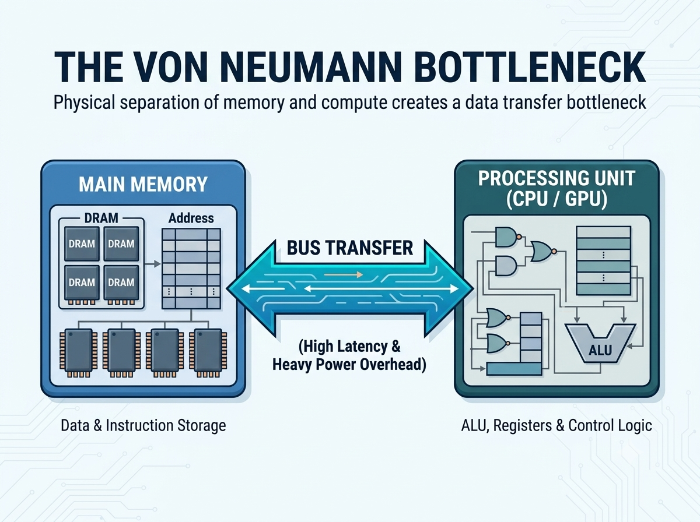
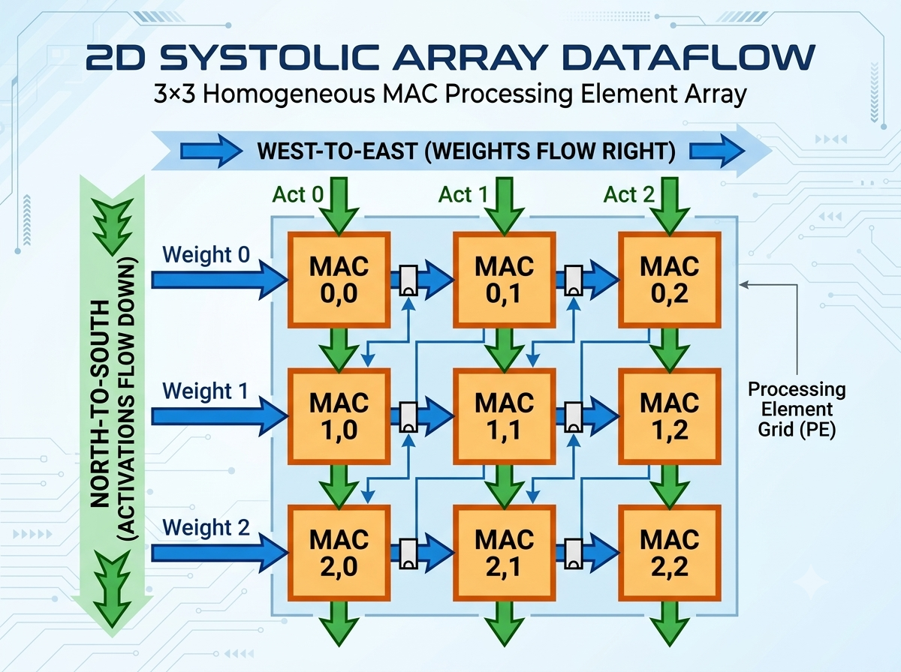
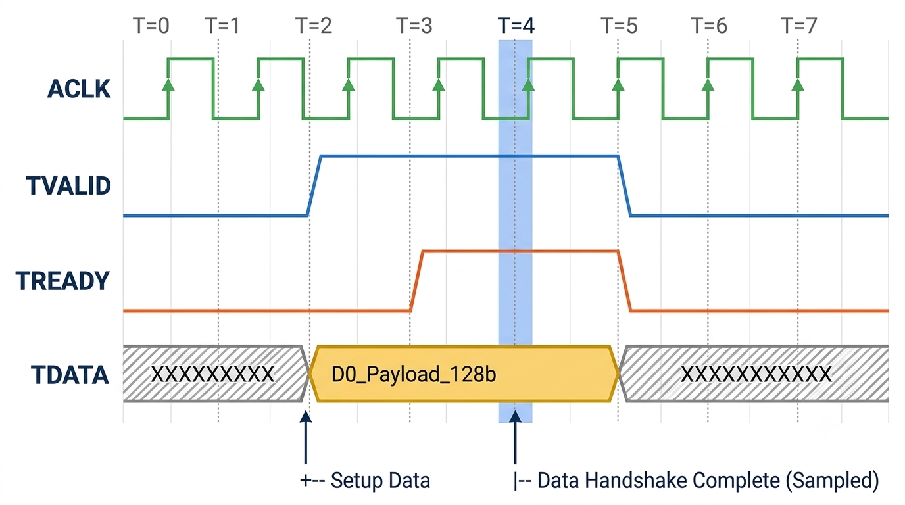
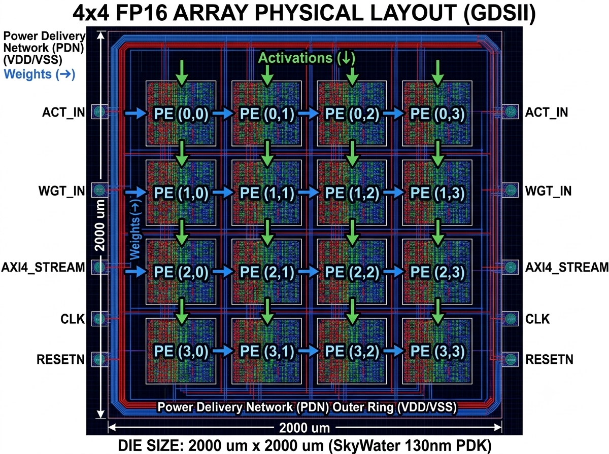
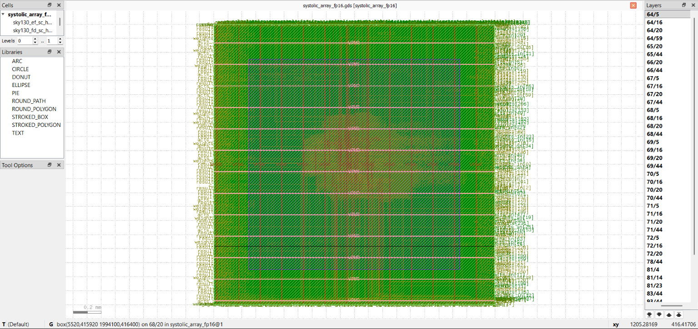

# 4×4 IEEE-754 FP16 Systolic Array Hardware Accelerator IP
### Silicon-Verified RTL-to-GDSII Deep Learning Matrix Compute Engine on SkyWater 130nm

An open-source, full-stack ASIC implementation of a **4×4 Output-Stationary Spatial Systolic Array** engineered for General Matrix Multiply (GEMM) acceleration in deep learning inference. The IP features a custom **IEEE-754 Half-Precision Floating-Point (FP16)** datapath, cycle-accurate **AMBA AXI4-Stream** system interfacing, and sign-off physical verification on the **SkyWater 130nm high-density (`sky130_fd_sc_hd`) process node** via the OpenLane/OpenROAD automated EDA flow.

---

## Key Silicon Specifications

| Metric / Parameter | Design Value | Architectural & Silicon Context |
| :--- | :--- | :--- |
| **Array Geometry** | **4×4 (16 PEs)** | Output-stationary, weight-streaming 2D grid |
| **Arithmetic Precision** | **IEEE-754 FP16** | 1-bit Sign, 5-bit Biased Exponent, 10-bit Mantissa (+1 implicit bit) |
| **Peak Throughput** | **5.33 GFLOPS** | 16 PEs × 2 FLOPs/cycle × 166.6 MHz |
| **Target Technology** | **SkyWater 130nm** | Standard cell library: `sky130_fd_sc_hd` (1.8V nominal core) |
| **Die Dimensions** | **2000 µm × 2000 µm** | 4.0 mm² total macro area accommodating 16 PEs and pad ring |
| **Core Target Utilization** | **45.0%** | Reserved routing track headroom for 64-bit and 256-bit orthogonal buses |
| **Sign-Off Clock Frequency** | **166.6 MHz** (T_clk = 6.0 ns) | Closed across PVT corners with positive setup and hold slack |
| **Pipelined INT8 Baseline** | **200.0 MHz** (T_clk = 5.0 ns) | Intermediate pipelining milestone evaluated prior to FP16 expansion |
| **Clock Distribution** | **Symmetric H-Tree** | Synthesized via TritonCTS with clock skew < 85 ps across 4,096+ DFFs |
| **System Interconnect** | **AMBA AXI4-Stream** | 128-bit streaming input (`s_axis_tdata`), 256-bit matrix output (`m_axis_tdata`) |
| **Physical Sign-Off** | **DRC & LVS Clean** | Verified via KLayout/Magic and Netgen (0 DRC violations, 100% LVS match) |

---

## Architectural Overview

Traditional Von Neumann processors spend orders of magnitude more energy shuttling matrix operands across cache and DRAM hierarchies than executing arithmetic evaluations. Fetching a scalar operand from off-chip DRAM consumes up to **200× more energy** than a 32-bit floating-point Multiply-Accumulate operation.

  
   
  <em>Figure 1: Architectural comparison: The Von Neumann memory wall vs. localized spatial computing data reuse.</em>

This hardware accelerator implements a **2D spatial computing matrix**:
1. **Zero Intermediate Memory Access:** Matrix operands stream directly between adjacent processing elements over point-to-point metal wires rather than writing back to register files or external SRAM.
2. **Output-Stationary Execution:** Accumulator values remain locked within localized PE registers during the dot-product evaluation, eliminating high-capacitance accumulation routing across the array.
3. **Wavefront Alignment:** Input vectors are skewed by (i + j) clock cycles to guarantee cycle-accurate synchronization across the diagonal compute wave.

---

## Microarchitecture & Datapath Operation

### 1. 2D Systolic Array & Wavefront Propagation

  
   
  <em>Figure 2: Orthogonal weight streaming (West-to-East) and activation streaming (North-to-South).</em>

* **Data Streaming:** Weights enter via the West boundary and step horizontally one column per clock cycle. Activations enter via the North boundary and step down one row per clock cycle.
* **Wavefront Synchronization:** To ensure matrix elements A_ik and B_kj intersect at PE_ij at the correct operational cycle, inputs are staggered using boundary delay registers: `Delay(Row i, Col j) = (i + j) * T_clk`.

### 2. IEEE-754 FP16 Multiply-Accumulate (MAC) Core

Each Processing Element processes standard half-precision numbers formatted according to IEEE-754:
* **Bit 15:** Sign (S)
* **Bits [14:10]:** Biased Exponent (E)
* **Bits [9:0]:** Mantissa Fraction (M)

Evaluation formula:
`V = (-1)^S * 2^(E - 15) * (1 + M / 1024)`

* **Mantissa Multiplication:** The implicit leading 1 is appended (1.M) to form 11-bit operands, evaluating an 11×11 unsigned product (22-bit intermediate vector).
* **Exponent Datapath:** Parallel exponent summation with bias adjustment: `E_res = E_A + E_B - 15`.
* **Normalization & Rounding:** Dynamic Leading Zero Detection (LZD), variable barrel shifting, and Round-to-Nearest-Even (RNE) repacking directly integrated within each PE.

### 3. AMBA AXI4-Stream Interconnect Wrapper

The accelerator core is integrated into a System-on-Chip (SoC) environment using an **AMBA AXI4-Stream IP wrapper** (`systolic_array_axi_wrapper.v`).

  
   
  <em>Figure 3: Cycle-accurate timing diagram showing TVALID/TREADY handshaking and 128-bit bus sampling at active clock edge T = 4.</em>

* **Input Streaming Port (`s_axis_*`):**
  * `s_axis_tdata[127:0]`: Carries 8 packed 16-bit half-precision values per cycle (Upper 64 bits = Weights for 4 rows; Lower 64 bits = Activations for 4 columns).
  * `s_axis_tvalid`: Asserted by host DMA controller when operand payload is valid.
  * `s_axis_tready`: Driven high by accelerator when internal pipeline registers are ready to consume.
* **Output Streaming Port (`m_axis_*`):**
  * `m_axis_tdata[255:0]`: Writes back all 16 calculated matrix results simultaneously (16 PEs × 16 bits = 256 bits).
  * `m_axis_tvalid`: Asserted when computation wavefront settles into output stages.
  * `m_axis_tready`: Monitored to provide backpressure flow control if host memory is busy.

---

## Timing Closure & Pipelining (STA)

Static Timing Analysis (STA) was executed using OpenROAD timing engines under standard worst-case and best-case corners:
* **Setup Constraint:** `T_clk >= t_prop + t_comb + t_setup + t_skew`
* **Hold Constraint:** `t_prop + t_comb >= t_hold + t_skew`

| Hardware Parameter | 8-Bit Integer (INT8) MAC Core | IEEE-754 FP16 MAC Core | Delta Factor |
| :--- | :--- | :--- | :--- |
| **Pipeline Latency** | 2 Clock Cycles | 4 Clock Cycles | 2.0x |
| **Combinational Delay** | < 4.5 ns | ~5.6 ns | 1.24x |
| **Max Operating Frequency** | **200.0 MHz** (T_clk = 5.0 ns) | **166.6 MHz** (T_clk = 6.0 ns) | 0.83x |
| **Equivalent Gate Count** | ~650 gates | ~3,200 gates | **~4.9x** |

---

## Physical Design & Silicon Implementation

The physical layout was generated using the automated **OpenLane ASIC flow** targeting the **SkyWater 130nm (`sky130_fd_sc_hd`)** standard cell library.

  
  &nbsp;&nbsp;&nbsp;&nbsp;
  
   
  <em>Figure 4: (Left) Sign-off GDSII floorplan highlighting dual-ring PDN on a 2000 µm × 2000 µm die. (Right) High-density standard cell routing capture in KLayout across metal layers (met1 through met5).</em>

* **Floorplan & PDN:** Die configured to 2000 µm × 2000 µm (4.0 mm²) with 45% core utilization. Power grid synthesized on thick top metals (`met4` and `met5`) with alternating VDD/VSS straps to suppress dynamic IR drop.
* **Clock Tree Synthesis (CTS):** Symmetric H-Tree synthesized with TritonCTS utilizing `sky130_fd_sc_hd__clkbuf_4` buffers. Insertion delay of 1.8 ns with maximum clock skew < 85 ps across 4,096+ internal flip-flops.
* **Sign-off Physical Verification:**
  * **DRC:** 0 violations confirmed via KLayout and Magic design rule checking.
  * **LVS:** 100% netlist-to-layout equivalence verified via Netgen.

---

## Documentation & Full Report

The complete, academic-grade engineering report is available in the repository:  
📄 **[docs/Comprehensive_Report.pdf](docs/Comprehensive_Report.pdf)**

---

## Author
**Tamanna N.**  
*Electronics and Communication Engineering*  
* **GitHub:** [@tam-stack-spec17](https://github.com/tam-stack-spec17)  
* **Portfolio:** [tamanna-portfolio-navy.vercel.app](https://tamanna-portfolio-navy.vercel.app/)  
* **LinkedIn:** [tamanna-n-057822336](https://www.linkedin.com/in/tamanna-n-057822336/)